<p align="center">
  
</p>

<p align="center">
  
  
  
  
</p>

<p align="center"><b>A daily forecast for the market, like a weather app for SPY, QQQ, gold and bonds.</b><br>
Every trading day ahead gets a signed expected return, the size of the likely move, and the events behind it.</p>

---

## What you see

| | |
|---|---|
| **+0.11%** | Expected return for the session, close to close. Honest numbers are small: a few tenths of a percent. |
| **±0.81%** | Typical size of the move. This is where the model has real skill. |
| **55% up** | Chance the session closes higher. |
| **80% range** | Four sessions out of five should close inside it. |
| ⚡ | High-risk session: Fed day, CPI, jobs, earnings, or an unusually wide expected move. |

Each market gets its own page:
- **Morning brief** under the title: the next session in one line, the week ahead and what to watch.
- **Day, week and month views:** a 21-session calendar with week totals, a weekly list, and a month outlook with pullback odds and a fan of likely paths.
- **Why:** each day's lean broken into its causes, such as reversal after a big drop, pre-Fed drift or turn of the month.
- **Track record:** how the model has done out of sample, including where it does no better than "always up".

Swipe sideways (or use ← →) to move between markets the way macOS moves between desktops. Out of the box it ships five: **SPY, QQQ, IWM, GLD and TLT**. Add any ticker from the search box; your list stays on your device. Press **i** or the Info button for the field guide.

## Run it

```bash
git clone https://github.com/RyFinance/voladaily && cd voladaily
python -m venv .venv && .venv/bin/pip install -r requirements.txt
.venv/bin/python -m voladaily serve        # http://127.0.0.1:8769
```

The first load of a ticker downloads its history and fits the models (about a minute); after that it is cached under `cache/`.

```bash
.venv/bin/python -m voladaily today SPY            # next sessions and the month, in the terminal
.venv/bin/python -m voladaily earnings NVDA AAPL   # next earnings: expected move, options-implied, past reactions
.venv/bin/python -m voladaily score                # walk-forward scoreboard -> out/scoreboard.html
```

Single stocks need `SEC_USER_AGENT="your-name your-email"` set: SEC asks every client for a contact address. It is only ever sent to sec.gov.

## How it works

**Size.** A HAR model on log realized variance (overnight gap plus the Garman-Klass intraday range), fed by:
- the VIX term structure (VIX1D, VIX9D, VIX, VIX3M), turned into a forward variance for each future day;
- scheduled events: CPI, jobs, GDP, PCE, PPI, retail sales, Fed decisions and the day after, options expiry, quad witching, US elections;
- for single stocks, earnings dates from SEC filings, with their own scale and tail shape;
- calendar effects: Mondays, long weekends, half days.

Probabilities come from a calibrated Student-t. For index ETFs, tomorrow is blended 50/50 with VIX1D, which beats either alone since 2022. The month outlook is a Monte Carlo where volatility keeps evolving along each path.

**Direction.** A heavily shrunk ridge regression on effects that are well documented: short-term reversal, 12-1 momentum, pre-Fed drift, turn of the month, day of week, the VIX level and slope, and the gap between realized and implied volatility. Every forecast is decomposed into those parts, which is where the "why" comes from.

## Scoreboard (2010-01 to 2026-10, out of sample)

Size, QLIKE loss (lower is better), Diebold-Mariano t-stats:

| | vs VIX alone | Events on top of HAR + VIX | vs VIX1D since mid-2022 |
|---|---|---|---|
| SPY | −6.5%, t −9.6 | t −2.1 | tie (t +0.4) |
| QQQ | −3.1%, t −5.3 | t −1.8 | tie |
| IWM | −2.3%, t −4.3 | t −2.3 | tie |
| TLT | −9.6%, t −9.7 | t −2.4 | better (t −4.2) |
| GLD | −11.4%, t −3.2 | t −1.9 | better (t −2.7) |

- SPY's 80% and 95% ranges held 79.6% and 95.4% of moves.
- Month outlook: forecast 1%+ days average 5.0 against 5.0 actual (correlation 0.67).
- Earnings term: 8.1% lower QLIKE across 11 large stocks; earnings-day 80%/95% ranges held 77.8% and 92.2%.
- Direction: out-of-sample R² of +0.47% on SPY and +0.38% on QQQ. Real but small, and its sign alone does not beat "always up". The app says so on every page.

## Data (all free)

| What | Where |
|---|---|
| Prices | Yahoo, via yfinance |
| VIX family | Yahoo, and CBOE for VIX1D |
| Past release dates | ALFRED (St. Louis Fed) |
| Upcoming release dates | FRED release calendar |
| Fed meetings | federalreserve.gov |
| Earnings dates | SEC EDGAR 8-K Item 2.02 matched to 10-Q/10-K |
| Trading days | `exchange_calendars` |

## Layout

```
voladaily/   data.py · model.py (size) · direction.py · earnings.py · forecast.py · score.py · server.py · cli.py
web/         index.html · style.css · app.js   (no build step, no framework)
SPEC.md      the original research plan
```

<sub>Forecasts are odds, not promises. Nothing here is investment advice.</sub>
